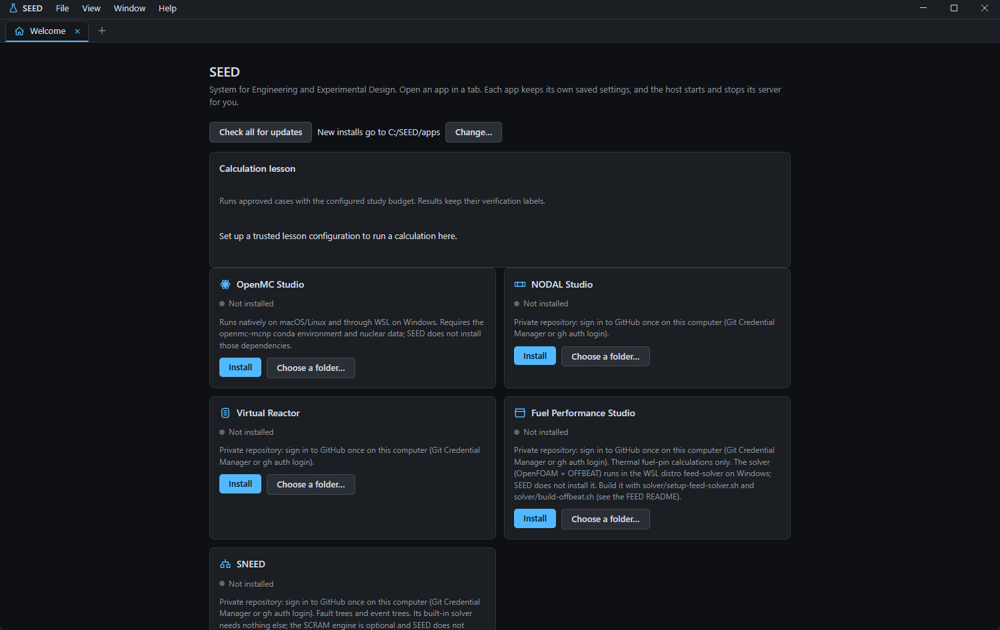
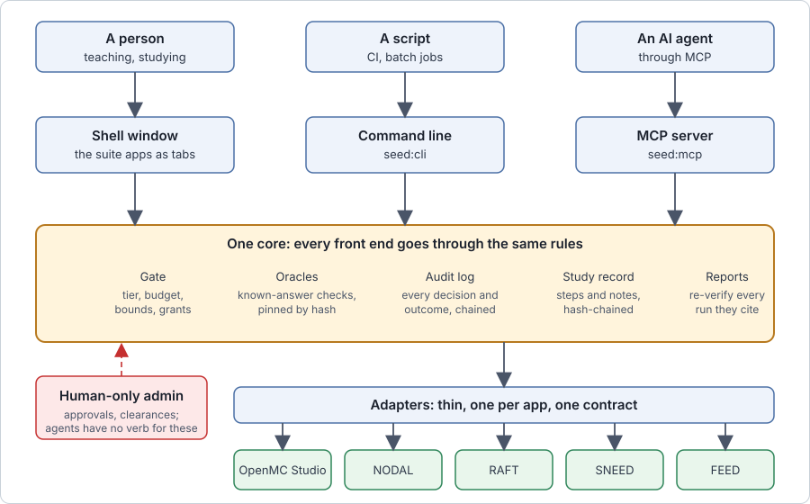
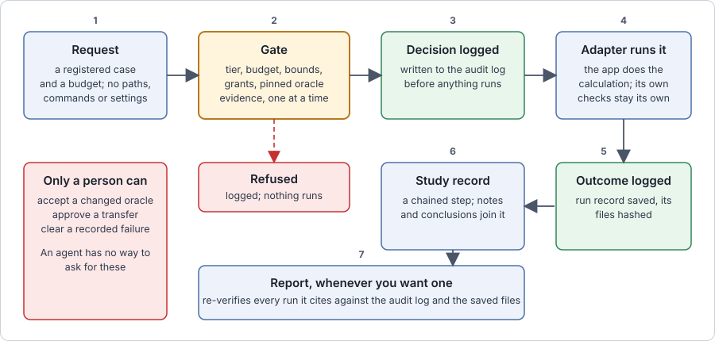
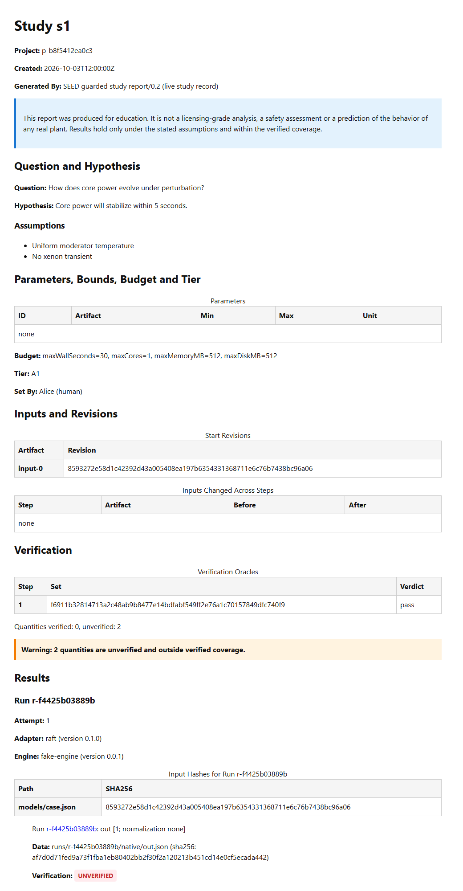

# SEED: System for Engineering and Experimental Design

**Status: experimental and educational. Not validated for safety, licensing or operation.** SEED is a teaching and research tool; nothing it produces should be relied on for a real reactor, a licence application or an operating decision without independent checking.

## What it is

SEED is a desktop host and a command-line and agent interface for a small suite of nuclear engineering teaching apps. It does two things:

1. **A shell.** One window that opens the suite apps (OpenMC Studio, NODAL, RAFT, SNEED and FEED) as tabs, installs and updates them from a catalog, and checks what each one needs before it launches.
2. **A harness for running experiments through an agent or a script.** A guarded core that lets a person, a script or an AI agent describe a study, run calculations in the apps, and get back results with their evidence, while the rules that matter (who may run what, how much, and what counts as a trustworthy result) are enforced in the code and not left to the agent's good behaviour.



It is for students and instructors who want reproducible, inspectable studies with the suite's apps, and for anyone building an agent workflow on top of them.



## What works today

- **The shell:** opens the suite apps as tabs, adopts or installs them from the catalog, runs prerequisite checks. See [shell setup](docs/shell.md).
- **Adapters** for OpenMC Studio, NODAL, RAFT, SNEED (PRA) and FEED, each a thin layer beside the app's own entry points. The app, not SEED, owns its physics and its checks. See [adapters](docs/adapters-shared.md).
- **A command-line tool and an MCP server over one core**, so a rule enforced for one is enforced for the other. See [the CLI](docs/host-cli.md) and [MCP access](docs/mcp.md).
- **Guarded runs.** A run is admitted only if the actor's tier, the study's budget and bounds, the pinned oracle evidence and the registered case all allow it; each decision is written to an audit log. See [policy and oracles](docs/policy-and-oracles.md) and [the run dispatcher](docs/run-dispatcher.md).
- **Oracles.** Each app keeps its own known-answer checks. SEED pins them by hash, runs them, and blocks runs when the evidence fails or changes without a human accepting it.
- **Studies.** Bounded parameter sweeps, a hash-chained study record, notes, reconciliation of the record with the audit log, and a self-contained report that re-verifies every run it cites. See [sweeps](docs/sweeps.md), [the study record](docs/study-record.md) and [reports](docs/study-report.md).
- **Transfers between apps** (for example heating from OpenMC to FEED, or a depletion record's burnup into FEED) under a human-approved recipe. See [transfers](docs/transfer-recipe.md).
- **Read-only model queries** that ask a registered model exact questions without running a calculation. See [model queries](docs/query-model.md).
- **Packages.** A component and package contract that plans installs across apps and their dependencies. See [packages](docs/packages-cross-app.md).

### What happens to a run



### What a report looks like



This is the top of a report made from SEED's own test fixture, which uses a fake engine, so it shows the layout and not a real calculation. A report is a folder: a self-contained HTML page, a Markdown copy, and the evidence and files it rests on. It states what the study asked, what the human set, which oracle evidence was pinned, and it labels every quantity VERIFIED, UNVERIFIED or STALE. It lists the steps and who took them, and it re-checks every run it cites against the audit log and the saved files before it is written.

## Limits

- Experimental software. The interfaces are versioned (contracts v0.1 are final; a change means a new version and a migration), but expect rough edges.
- **SEED protects against an agent that makes mistakes while working through the CLI or MCP.** It does not protect against an agent that has shell access to your account, which can do anything you can. The threat model is in [the decisions record](docs/DECISIONS.md).
- Approvals (accepting a changed oracle, approving a transfer, clearing a recorded failure) are human actions on a separate command line; agents have no verb for them.
- Several apps in the catalog are not public yet. SEED installs a catalog app only if you can reach its repository, so for now most of the suite is available to its authors only.
- The graphical front end for experiments (comparison views, the guided report, a console pane) is not built. Studies are run through the CLI or MCP.
- Replay of earlier runs, report comparisons and result caching are designed but not built.
- macOS and Linux launching of some apps is less tested than Windows. On Windows, OpenMC runs through WSL.
- Calculation engines (OpenMC, nuclear data, OFFBEAT and others) are installed separately by their own instructions and are not part of SEED.

## Install and first run

You need Node 24 or later (with npm) and Git.

On Windows, double-click `Start SEED.cmd`. On macOS, run `Start SEED.command`. If the dependencies are missing it asks before running `npm ci --include=dev`; the first setup needs an internet connection. On other platforms run:

```
npm ci --include=dev
npm start
```

Adopt app clones you already have from the Welcome page, or install from the catalog. Apps with their own requirements (a conda environment, WSL, a solver) list them as checks that you can see before launch.

To use the harness without the window:

```
npm run build
npm run seed:cli      # the guarded command line (read docs/host-cli.md first)
npm run seed:mcp      # the MCP server
npm run seed:admin    # the human-only commands
```

The CLI and MCP server need a host configuration that a person provisions outside the project folder; [the CLI guide](docs/host-cli.md) shows how.

To run the tests: `npm test`. Some tests need the suite apps or a WSL distribution and report clearly when they are skipped.

## Documentation

- [PLAN.md](PLAN.md): what is built and what is planned.
- [TODO.md](TODO.md): the working list.
- [docs/](docs/README.md): design notes, decisions with their reasons, contracts, and a guide for each adapter.

## Licence and third-party software

SEED is released under the [MIT licence](LICENSE).

It depends on open source packages that keep their own licences: Electron, the Model Context Protocol SDK, Ajv, Zod, and (for development and tests) TypeScript, Vitest and Playwright. [THIRD_PARTY_NOTICES.md](THIRD_PARTY_NOTICES.md) lists every package with its version, licence and licence text; it is generated from `package-lock.json`, and a test fails when the two disagree. SEED does not bundle the suite apps or any calculation engine; each is installed separately and carries its own licence and terms.

SEED is not affiliated with or endorsed by the developers of the programs it can work with, such as OpenMC and OFFBEAT.
